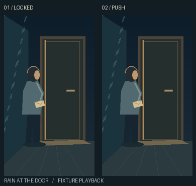

# TakeFerry

TakeFerry is an open-source directing skill and MCP toolkit for screenwriters using Hermes Agent. Paste a scene into Hermes, choose a shot from its breakdown, and tell it where to shoot first. On a platform such as LibTV, Hermes builds the workflow on your own canvas. Ask for the same shot on a second platform when you want to compare takes.

[Set up TakeFerry in Hermes](docs/setup.md) · [Try the offline scene](#try-the-rainy-door-scene) · [中文说明](README.zh-CN.md)

## Direct a shot

> Use image A for her face and B just for the light. Five seconds, vertical. She turns when the key clicks at two seconds. Keep the sound of the rain. Give me a locked shot on LibTV first.

On LibTV, Hermes chooses a model that accepts both images, writes the prompt, and connects the references to a video node you can open and edit. Before a paid take, Hermes shows you the account, model, final prompt, and quoted cost. If the platform hasn't supplied a price, Hermes marks it as unknown. Each take you approve uses that platform's credits.

"Try the same shot on Pippit" keeps the framing and timing. You choose which references to share and review any differences before approving a take on your Pippit account. Or pick a take you like and say, "Keep this one. Try a slower push-in." Hermes gives the revision its own node and keeps both takes on the storyboard.

If you want to reuse that way of working, ask Hermes to draft a private skill for your profile. For example, next time you change only the camera move, have it reuse the face and lighting references you already approved. [Read the directing skill](skills/takeferry/SKILL.md)

## Try the rainy-door scene

You can try the scene with Python 3.9 or later, before setting up Hermes or opening a platform account. The rehearsal uses bundled storyboard clips on two simulated canvases and spends zero credits. Download `takeferry.pyz` and run the command below. [Release downloads](https://github.com/Tsunami1212/takeferry/releases/tag/v0.1.0-alpha.2)

```sh
python3 takeferry.pyz demo --output rainy-door-demo
```

Or run it from source.

```sh
git clone https://github.com/Tsunami1212/takeferry.git
cd takeferry
python3 -m takeferry demo --output rainy-door-demo
```



Open `rainy-door-demo/rain-at-the-door.canvas` in Obsidian to see how the four takes relate. The writer chose the slower push-in and kept seconds 1.0 to 4.5. Open `rain-at-the-door.zip` for the full five-second original and `cut-list.csv`. Beside it, `canvases.json` shows where the references connect, `takes.json` records each take, and `branch-camera-movement/SKILL.md` holds the private skill draft.

## Connect your own canvas

For a live shoot, you need a working Hermes Agent with a language model configured. Install the directing skill in your Hermes profile. Run `python3 -m takeferry config` from the checkout or `python3 takeferry.pyz config` with the download. Copy the printed Model Context Protocol (MCP) settings into Hermes and authorize the platform you want to use. Your model provider handles any charges for the Hermes conversation. [Setup and credentials](docs/setup.md)

TakeFerry runs a local MCP server to keep your take history and selections. For LibTV, Hermes also connects to LibTV's official MCP server. For Pippit (小云雀), the local server uses Pippit's official media CLI and Canvas SDK to attach the video to the chosen node and check it there.

## Choose another canvas

| What you want to work with | Where |
| --- | --- |
| An editable video node with connected references | LibTV, Pippit, Magnific Spaces |
| A saved workflow and its job output | Comfy Cloud, local ComfyUI |
| A video on the platform's canvas | TapNow, RunningHub rhTV |
| A generated media asset | Runway, Krea, Figma Weave |
| An editable storyboard or shot list | FigJam, Miro, Canva, Excalidraw, or a local JSON Canvas file in Obsidian |

```sh
python3 takeferry.pyz catalog
python3 takeferry.pyz config --provider magnific comfy miro
python3 takeferry.pyz demo --canvas-tour --output canvas-tour
```

The offline tour adds eight simulated runs to the four above. It reuses one clip so you can inspect what each platform would return. The skill includes eight published guides on ComfyUI, shot design, continuity, and JSON Canvas. [Canvas capabilities](docs/canvases.md) · [Skill sources and licenses](skills/takeferry/references/skill-library.md)

We've tested the offline workflow, checked where hosted connectors start login, and read Excalidraw's public tool reference over MCP. Paid renders, edits to signed-in boards, and saving a private skill in a live Hermes profile still need verification. [Test results](docs/verification.md)

The core, MCP server, and example use the Python standard library. Run the tests with `python3 -m unittest discover -s tests -v`. [Contributor guide](CONTRIBUTING.md) · [Adapter notes](docs/adapters.md) · [Apache-2.0 license](LICENSE)
