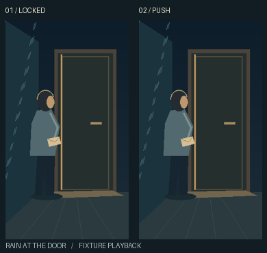

# TakeFerry 中文介绍

TakeFerry 是一套给编剧用的开源导演技能和 MCP 工具，装在你自己的 Hermes Agent 里。把一场戏贴给 Hermes，它会先列出分镜。你挑一镜，交代怎么拍、先去哪家。选 LibTV，Hermes 就在你的 LibTV 画布上搭工作流。看过第一条，再决定要不要拿同一镜去小云雀对拍。

[English README](README.md) · [把 TakeFerry 接入 Hermes](docs/setup.md) · [离线试拍](#先试一个镜头)

## 编剧怎么交代一镜

> A 图定女主的脸，B 图只参考灯光。五秒竖屏。第 2 秒钥匙一响，她就回头，雨声留着。先在 LibTV 来一条固定机位。

在 LibTV 上，Hermes 会选能接这两张参考图的模型，写提示词，把两张图接到视频节点上。你随时可以打开原画布改。提交前，Hermes 会把账号、模型、最终提示词和平台报价给你看。平台没报价就标成未知。你点头后才提交这一条，花的是该平台账号的积分。

想看小云雀怎么拍，就说“机位和时间都照旧，去小云雀试一条”。Hermes 会先跟你确认哪些参考图可以带过去，把两边设置上的差别说清楚，再请你确认这次试拍。也可以挑中一条说“这条留着，镜头再推慢一点”，原版和改版都会留在分镜板上。下次改运镜还想沿用定好的脸和光，可以让 Hermes 把这套做法写成你自己的私有技能草稿。[导演技能原文](skills/takeferry/SKILL.md)

## 先试一个镜头

只需 Python 3.9 或更高版本就能跑示例。它用两张模拟画布和随包附带的动态分镜，全程离线，消耗 0 平台积分。从源码目录运行下面的命令。

```sh
python3 -m takeferry demo --output rainy-door-demo
```

也可以下载 `takeferry.pyz`，运行 `python3 takeferry.pyz demo --output rainy-door-demo`。[发行页](https://github.com/Tsunami1212/takeferry/releases/tag/v0.1.0-alpha.2)



用 Obsidian 打开 `rainy-door-demo/rain-at-the-door.canvas`，能看到四次试拍分别从哪一条改来。编剧最后选了慢推那条，只用第 1 秒到第 4.5 秒。`rain-at-the-door.zip` 里有完整的五秒原片和剪辑单 `cut-list.csv`。想看参考图接到了哪里，打开同目录的 `canvases.json`。`takes.json` 记录着每次试拍，`branch-camera-movement/SKILL.md` 是从这次改镜头整理出来的技能草稿。

## 使用自己的平台账号

要操作真实画布，先准备一个已配好语言模型的 Hermes Agent。把导演技能装进自己的 Hermes 配置，运行 `python3 -m takeferry config`，把输出的 MCP 设置填进去，再登录要用的平台。LibTV 提供官方 MCP 服务。小云雀通过 TakeFerry 的本地服务调用官方 CLI 和 Canvas SDK。Hermes 对话本身的模型费用取决于你的配置。[接入步骤](docs/setup.md)

## 试用其他画布

除了 LibTV 和小云雀，Magnific Spaces 也能编辑视频节点。Comfy Cloud 和本地 ComfyUI 使用保存的工作流。TapNow 和 RunningHub rhTV 把视频放回平台画布，Runway、Krea 和 Figma Weave 可以取回生成的素材。若只是要和团队讨论分镜，可以选 FigJam、Miro、Canva、Excalidraw，或在 Obsidian 里打开本地分镜板。[各平台能做什么](docs/canvases.md)

`python3 -m takeferry catalog` 可以查看接入清单。运行 `python3 -m takeferry demo --canvas-tour --output canvas-tour` 可以离线走完十条视频接入路径，对照每家会交回什么。技能包还附有八份上游指南，涵盖 ComfyUI、分镜、运镜、角色连续性和 JSON Canvas。[随包指南与授权](skills/takeferry/references/skill-library.md)

当前版本已验证离线试拍，检查过托管服务的登录入口，也通过 MCP 读取了 Excalidraw 的公开工具说明。付费实拍、登录后写入远程分镜板，以及把私有技能保存到真实 Hermes 配置中，仍待实测。[验证记录](docs/verification.md)
